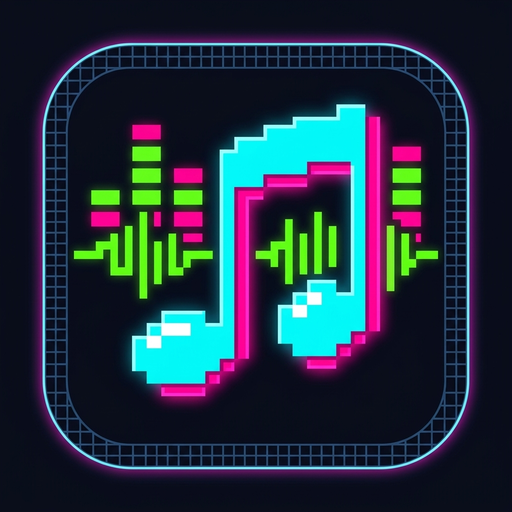
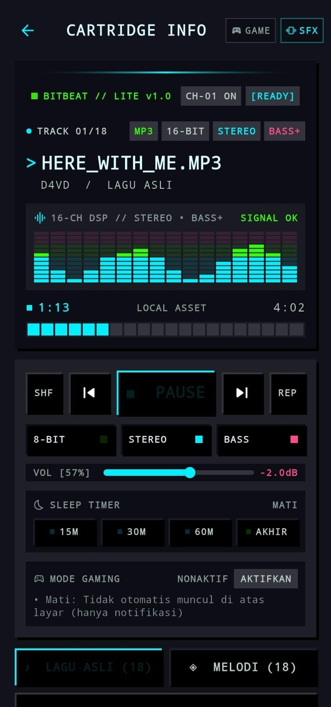
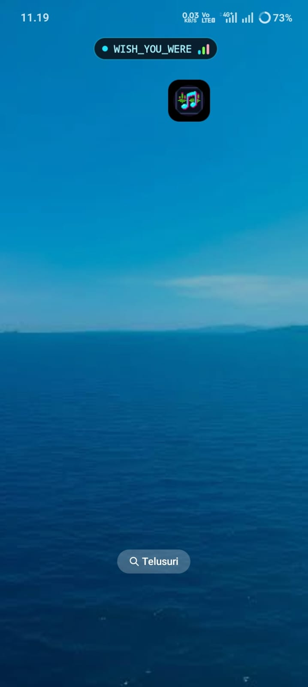
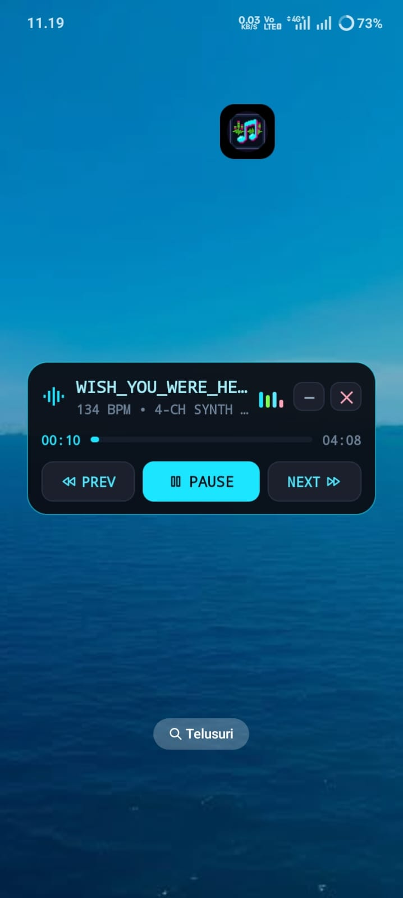
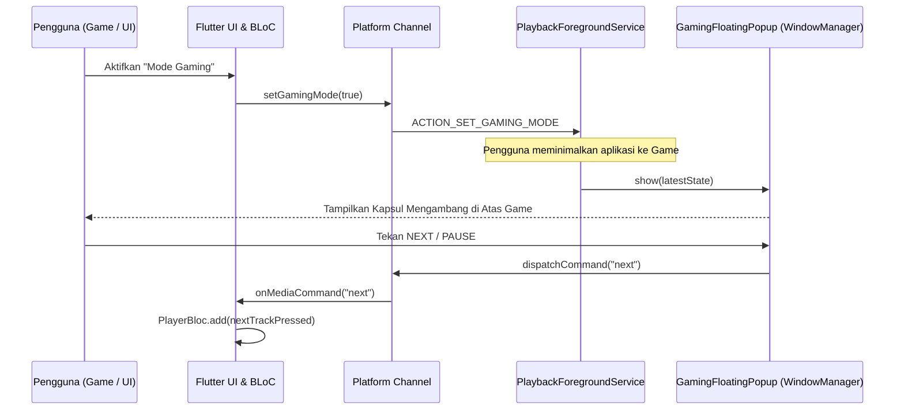

<div align="center">



# 🕹️ BitBeat (ビットビート)
### Retro Cyberpunk 8-Bit Cartridge Music Player with Native Android Gaming HUD

[](https://flutter.dev)
[](https://dart.dev)
[](https://android.com)
[](#-arsitektur--desain-sistem)
[](LICENSE)

*A high-performance retro-themed music player engineered with Flutter, featuring deep Android native interop, custom DSP effects, and an interactive draggable floating HUD overlay designed for uninterrupted mobile gaming.*

</div>

---

## 📖 Tentang Proyek

Sering kali saat bermain game di Android, memutar musik di latar belakang menghadapi dua kendala utama:
1. **Audio Reclaim**: Game merebut *audio focus*, menyebabkan musik otomatis terjeda (*pause*).
2. **Context Switching**: Pemain harus keluar dari game (*minimize*) hanya untuk sekadar mengganti atau menjeda lagu.

**BitBeat** memecahkan masalah ini dengan menggabungkan antarmuka retro cyberpunk bergaya konsol portabel dengan sistem **Floating Gaming HUD** tingkat native (Kotlin), memungkinkan pengguna mengontrol musik langsung di atas game tanpa meninggalkan permainan.

---

## 📱 Preview Aplikasi

<div align="center">
  <table>
    <tr>
      <th align="center"><b>🕹️ Layar Pemutar Utama (In-App)</b></th>
      <th align="center"><b>🎮 Kapsul Melayang (Mode Gaming)</b></th>
      <th align="center"><b>⚡ Kontrol Deck Melayang (Expanded)</b></th>
    </tr>
    <tr>
      <td align="center" width="33%">
        
        <br/>
        <sub><i>Antarmuka terminal cyberpunk, visualizer real-time, dan DSP chip 8-bit</i></sub>
      </td>
      <td align="center" width="33%">
        
        <br/>
        <sub><i>Kapsul minimalis always-on-top melayang di atas aplikasi & game lain</i></sub>
      </td>
      <td align="center" width="33%">
        
        <br/>
        <sub><i>Menu kontrol cepat (Play/Pause, Next/Prev, Seekbar, dan tombol Dismiss ✕)</i></sub>
      </td>
    </tr>
  </table>
</div>

---

## ✨ Fitur Unggulan

### 🎮 1. Mode Gaming (Floating HUD Overlay)
- **Always-on-Top Kapsul Melayang**: Menggunakan Android `WindowManager` (`TYPE_APPLICATION_OVERLAY`) yang melayang di atas aplikasi/game lain.
- **Draggable & Orientation Aware**: Kapsul dapat digeser bebas dan otomatis menyesuaikan koordinat aman (*safe zone*) pada posisi *portrait* maupun *landscape*.
- **Auto-Dimming & Collapse**: Kapsul meredup otomatis saat *idle* agar tidak mengganggu pandangan saat bermain game intensif.
- **Full In-Game Controls**: Tap kapsul untuk membuka menu cepat (Play/Pause, Previous, Next, Seekbar, dan visualizer).
- **Tutup Cepat (`✕`)**: Tombol dismiss langsung dari overlay yang otomatis menyinkronkan status Mode Gaming kembali ke aplikasi.

### 🕹️ 2. Cyberpunk Retro UI & CRT Aesthetics
- Antarmuka visual bergaya *cartridge game* era 80/90-an dengan palet warna neon cyan, pink, dan hijau terminal.
- Animasi visualizer equalizer dinamis real-time.
- Umpan balik haptik dan efek audio klik retro 8-bit saat menekan tombol.
- Dual-channel switcher: Lagu versi **Original** vs versi **8-Bit Melody Synth**.

### 🎛️ 3. Audio DSP & Filter Suara
- **8-BIT Filter**: Modulasi kecepatan dan efek suara chiptune arcade.
- **STEREO Widening**: Efek pelebaran medan suara spasial.
- **BASS Boost**: Penguatan frekuensi rendah melalui akselerasi audio native.

### 📱 4. Arsitektur Native Android Kuat
- **Smart Audio Focus**: BitBeat hanya menjeda musik saat ada panggilan telepon nyata (*cellular call / ringtone*), dan tetap memutar musik bersamaan dengan efek suara game.
- **Persistent FlutterEngine**: Engine dicache dan diikat ke *foreground service* sehingga musik tidak akan dimatikan paksa oleh sistem operasi (*Android LMK / ColorOS battery management*) saat game berjalan berat.
- **MediaSession & Lockscreen Notifikasi**: Integrasi penuh dengan sistem multimedia Android, tombol headset/earbuds Bluetooth, dan kontrol di lock screen.

### ⏱️ 5. Sleep Timer & Session Persistence
- Pilihan timer tidur: *15 Menit, 30 Menit, 60 Menit,* atau *Sampai Lagu Selesai*.
- Penyimpanan status otomatis (*track terakhir, posisi detik, volume, efek DSP, mode gaming*) via `SharedPreferences`.

---

## 🏗️ Arsitektur & Desain Sistem

Aplikasi ini dibangun dengan prinsip **Clean Architecture & Separation of Concerns**:

```
lib/
├── app.dart                                # MaterialApp & Theme setup
├── main.dart                               # Entry point
└── features/player/
    ├── bloc/                               # Business Logic Component (BLoC)
    │   ├── player_bloc.dart                # Event/State orchestrator & session persistence
    │   ├── player_event.dart               # Freezed sealed event classes
    │   └── player_state.dart               # Immutable UI state models
    ├── data/                               # Data Sources & Platform Interop
    │   ├── audio_player_repository.dart    # Wrapper player & MethodChannel communicator
    │   ├── player_session_storage.dart     # SharedPreferences local persistence
    │   └── retro_feedback_service.dart     # Soundpool SFX trigger
    ├── domain/                             # Core Business Entities
    │   └── track.dart                      # Track entity & playlist registry
    └── presentation/                       # UI Widgets & CRT Display
        └── player_page.dart                # Responsive terminal screen, deck, & controls
```

### Alur Komunikasi Flutter ↔ Android Native:



---

## 🛠️ Tech Stack & Dependencies

| Komponen | Teknologi | Keterangan |
| :--- | :--- | :--- |
| **Framework** | [Flutter](https://flutter.dev) (Dart 3) | Cross-platform UI Toolkit |
| **State Management** | [flutter_bloc](https://pub.dev/packages/flutter_bloc) | Predictable state container |
| **Immutability** | [freezed](https://pub.dev/packages/freezed) | Data class code generation & unions |
| **Audio Engine** | [just_audio](https://pub.dev/packages/just_audio) | Low-latency audio streaming & effects |
| **Local Storage** | [shared_preferences](https://pub.dev/packages/shared_preferences) | Key-value session caching |
| **Native Android** | Kotlin | `ForegroundService`, `MediaSession`, `WindowManager` Overlay |

---

## 🚀 Panduan Memulai (Getting Started)

### Prasyarat
- Flutter SDK (versi `^3.12.0` ke atas)
- Android SDK (minSdk 21, targetSdk 34)
- Editor: VS Code / Android Studio

### Langkah Instalasi

1. **Clone repository ini:**
   ```bash
   git clone https://github.com/USERNAME/my_music.git
   cd my_music
   ```

2. **Pasang dependensi Flutter:**
   ```bash
   flutter pub get
   ```

3. **Siapkan File Audio:**
   *Demi kepatuhan hak cipta, file musik `.mp3` dikecualikan dari Git.*  
   Silakan letakkan file lagu Anda ke dalam folder `assets/audio/`. Untuk panduan penamaan file lagu, silakan baca dokumentasi di [`assets/audio/README.md`](assets/audio/README.md).

4. **Jalankan Aplikasi:**
   ```bash
   flutter run
   ```

---

## ⚖️ Lisensi & Hak Cipta (Disclaimer)

- **Kode Sumber**: Dilisensikan di bawah lisensi MIT.
- **Aset Audio**: File lagu dalam aplikasi ini ditujukan untuk demonstrasi lokal. Proyek ini tidak mendistribusikan file musik berhak cipta pada repositori publik. Seluruh hak cipta musik adalah milik masing-masing artis dan pemegang hak cipta resmi.
